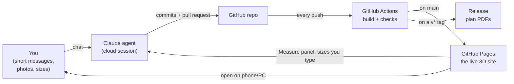
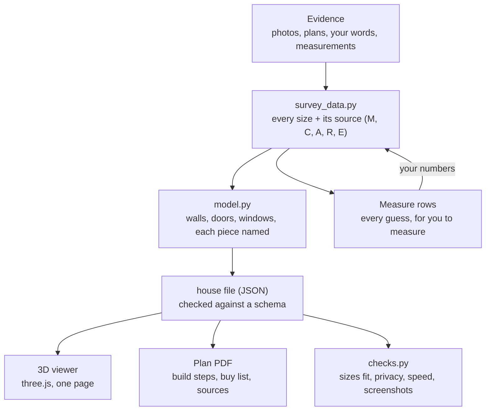
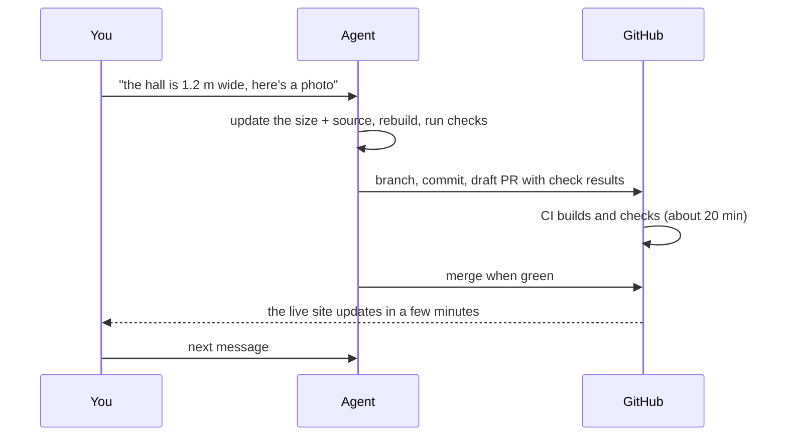

# Make your own home in 3D with a Claude agent: a guide for a friend

How we built our whole house as a live 3D site, planned every upgrade in it, and how you can do the same for yours, better and faster,
with a Claude agent doing the building. You do the deciding, measuring and photographing; the agent writes all the code.

What we ended with after about three weeks of short messages: a site on GitHub Pages that opens on the whole house in 3D, every room
walkable on a phone or PC, walls, floors and lights you can change, a plan PDF with a build guide, a buy list with sources and costs,
and a Measure panel where we type in real sizes as we get them. It's at V3.36 after about 240 commits, all made by agents.

---

## 1. What you need before you start

**Accounts (one evening)**
- A **GitHub** account and a new, empty repository (public if you want free GitHub Pages; see section 6 on privacy).
- A **Claude** plan that includes Claude Code (Pro or Max). Use **Claude Code on the web** (claude.ai/code) or the phone app:
  the agent works in its own cloud machine, so you never install anything.
- Install the **Claude GitHub app** on your repository when the session asks, so the agent can push and open pull requests.
- In the repository's Settings, Pages, set the source to **GitHub Actions** (the agent writes the workflow).

**Things for the house**
| What | Why | Tip |
|---|---|---|
| A floor plan of every floor | the agent's first ruler | the estate agent's plan from the listing: screenshot it (don't ask the agent to scrape property sites) |
| One room measured properly | it fixes the scale of everything else | pick the room you'll do first; walls, ceiling height, window and door positions, in mm or cm |
| A laser measure | 10× quicker than a tape | about £20–40 |
| Photos of every room | the agent reads layouts, finishes and where things are | 4 a room, one from each corner looking at the opposite one, landscape, ceiling and floor in shot |
| Outside photos | the shell, roof, windows | front, back, sides, from as square on as you can |
| A list of what you want to change | it becomes the plan | "a media wall in the living room", "new kitchen floor", "paint the hall" |
| Your devices | the site must run on them | tell the agent the exact phone and PC (ours: iPhone 15 Pro, RTX 5070 PC) on day one |

**Optional but worth it:** an iPhone Pro or iPad Pro with LiDAR and a scanning app (Polycam, or Apple's RoomPlan inside apps like
Magicplan or Canvas). A scan of each room gives the agent real sizes on day one instead of guesses. We didn't have one and spent days
fitting walls to photos.

---

## 2. How it fits together



**The data runs one way**, so a new size changes everything downstream by itself:



**One round of work:**



---

## 3. The steps

### Step 1: the rules file (day 1, before any code)
The agent reads `CLAUDE.md` at the root of the repo every session. It's the most important file you'll have. Start it with the
template in section 4 and **add a line every time you say "always" or "never"** to the agent. Ours grew to about 40 lines and every
one saved a repeat.

### Step 2: the kickoff
Open a Claude Code session on your empty repo and paste the kickoff prompt (section 5.1) with your floor plans and photos attached.
Ask for the **plan first**, in phases, before any building.

### Step 3: one room, done properly
Pick the room you'll change first. Measure it carefully. Get that one room accurate, walkable and looking right on your phone.
It becomes the ruler and the quality bar for the rest.

### Step 4: the whole house, rough
The agent scales the floor plans to your measured room and builds every floor. Every size it guesses is marked **E** and gets a row in
Measure. **Where the plan and reality don't fit, the room gives way** until you measure.

### Step 5: rounds
Send short messages: a photo, a size, "the door opens the other way", "make the walls pale mint". Each one is a small pull request,
a version number, and the live site updates. Check on your phone, reply, repeat.

### Step 6: the projects
For each thing you'll actually build: a full plan (steps, times, buy list with links and prices, fit proof that it fits). For the
ideas you're only looking at: one line each, so the plan doesn't bloat.

### Step 7: when it gets big, split the work
Ask the agent to split the next round into tasks (each naming the files it owns), then run several sessions side by side, one task each.
When you stop, ask for a handover (section 5.9) so the next agents start from the repo, not from memory.

---

## 4. A starter `CLAUDE.md` (copy, fill in, keep adding)

```markdown
# Rules for agents

- PRIVACY: this repo and its site are public. Never write my address, street, postcode, town, coordinates or anything that pins
  the house down, in any file, page, PDF, image, code comment, commit, PR or issue. Strip EXIF (location) from every photo.
  Run `python3 tools/privacy_check.py` before every commit (it checks hashes, never the words).
- Start each session with docs/STATE.md (what's true now: rewrite it, don't append, at the end of every PR) and docs/PLAN.md
  (the phases and the task board). Work the next open row; tick it in your PR.
- My choices in force: docs/DECISIONS.md (one line each, with my words and the date). Lessons learned: docs/NOTES.md.
- Every size comes from a cited source: M measured by me, C I said so, A the listing's (estate agent's) plan or photo, R your reading of a photo,
  E your estimate. Every E gets a row in the Measure panel. Where a plan size and reality don't fit, the room gives way.
- Every product's size and price cites its source (the retailer's or maker's page) in the plan's Sources list.
- The 3D is the site: it fills the screen and everything floats over it. It must run smoothly on [my phone] and [my PC].
- One command each: `python3 tools/build.py` builds everything into _site/; `python3 tools/checks.py` runs every check
  (paste its lines in the PR).
- Nothing built is committed (.gitignore). The workflow builds, checks and publishes GitHub Pages on every push to main.
- Keep the repo lean: photos as JPEG (quality 92), no file over 1.5 MB except my photos; delete what nothing uses.
- Core plan vs options: full build only for what I ask for by name; other ideas one line each (what, where, size, rough cost, source).
- Say less: short captions, cards and toasts. History goes in docs/HISTORY.md and git, not on the page.
- One task a PR, draft PRs, my words quoted at the top. Versions V1, V1.1 ... one a PR that changes the site.
- Keep my words for things: [your names for things, e.g. "the snug", "artisan oak"].
```

---

## 5. Prompts to paste

Short is fine: the agent asks when it needs to. These are the ones that did the most work for us.

### 5.1 Kickoff
> I want a live 3D model of my whole house, as a website on GitHub Pages, to plan and track upgrades. The 3D fills the screen and is
> the site; controls float over it. It opens on the whole house and you walk into rooms. It must run smoothly on [phone] and [PC].
> Attached: the floor plans of every floor, photos of every room and the outside, and [room] measured: [sizes].
> First: write CLAUDE.md (my rules, below), docs/PLAN.md (the work in phases with a status board), docs/STATE.md, house/HOUSE.md
> (every fact about the house) and house/EVIDENCE.md (what each size rests on). Then set up the build: Python for the model and
> the PDF, three.js bundled with esbuild, a GitHub Actions workflow that builds, checks and publishes Pages. Don't build rooms yet:
> show me the plan. [paste the rules from section 4]

### 5.2 New photos
> New photos of [room], attached. Read them against the model: fix what's wrong (layout, doors, windows, finishes), list what you
> changed and what you still guess. Strip EXIF, save as JPEG, add them to EVIDENCE.md.

### 5.3 New measurements
> Measured: [room] [what] [number] cm. Put them in, mark them M, take their Measure rows out, let the rooms give way, and tell me
> anything that no longer fits.

### 5.4 Compare with the photo
> Put my photo of [room] beside the same view in the 3D (fit the camera to the photo) and fix every difference you can see.

### 5.5 A project
> Plan [project] in [room]: a full build. Every piece's size and price from a cited source (link it). Prove it fits (clearances,
> doors opening, sockets). Steps in order with times and who does it, the buy list with links and a total, and a page in the plan PDF.
> Three options to look at, one line each.

### 5.6 Make it feel real
> Make [room] as real as [best room]: its own light by time of day, the right floor and wall finishes, soft furnishings, skirting,
> switches and sockets where they are. Show me before and after from the same view.

### 5.7 Speed on the phone
> On my [phone] it [freezes on opening / lags when I move / is slow from room to room]. Measure it (shaders built, texture uploads,
> draws a frame), set a speed budget the checks enforce, then fix the worst first. Show me the numbers before and after.

### 5.8 Split into tasks
> Split the next round into tasks that can run side by side. Each task: one row with what, the files it owns, what it waits for.
> Then do [task]. One task a PR.

### 5.9 Handover
> Stop and hand over for a new team. Update docs/HANDOVER.md (how it runs, what's open, what waits on me), the plan's board,
> docs/STATE.md, and put every lesson in docs/NOTES.md. Make sure everything is findable in GitHub, nothing only in your memory.

### 5.10 A review
> Review the whole site on my phone and PC as a first-time visitor: what's confusing, slow, ugly or wordy. Make a ranked list,
> then fix the top three.

### 5.11 Starting a new session (paste each time)
> Read CLAUDE.md, docs/STATE.md and docs/PLAN.md. Take the next open row. Tell me in two lines what you'll do, then do it.

---

## 6. What we learned (do these from day one)

1. **Privacy from the first commit.** A public repo is public forever (git keeps history). Our agent wrote a check that hashes every
   word in every file, PDF and the built site and compares with the hashes of the address's words, so the check itself never holds
   the address (`house/privacy_check.py` in our repo). Strip photo EXIF. If that's too much worry, use a **private repo**: Pages on a
   private repo needs a paid GitHub plan, or the agent can make the site a downloadable file instead.
2. **Decide the look early.** We rebuilt the design once ("it doesn't look anything like my old one"). Show the agent a picture or a
   site you like on day one, and say what you don't want (ours: no dashboards, side menus or lists of rooms).
3. **Test on your real phone early.** Our iPhone froze on opening long after the PC was fine. Name your devices in CLAUDE.md, and ask
   for a speed budget in the checks once the house is in.
4. **Every number has a source.** It stops the agent inventing sizes and tells you exactly what to measure next.
5. **The repo is the memory.** Agents forget between sessions. STATE.md (rewritten each PR), DECISIONS.md, NOTES.md and the plan's
   board carry everything. Anything said only in chat is lost.
6. **One command to build, one to check.** The agent pastes the check's output in each PR; you never read code.
7. **Nothing built is committed;** photos as JPEG not PNG. Our first repo got so big we started a fresh one.
8. **Say less.** Ask for short labels everywhere; agents over-write.
9. **Small rounds beat big asks.** One message, one change, one version, see it live, react.
10. **Running agents side by side** needs each task to own its files, and versions taken at merge time (they race).

---

## 7. Sources worth giving the agent

**The tech (all free)**
| What | Use |
|---|---|
| three.js (threejs.org) | the 3D in the browser |
| esbuild | bundles the page into one fast file |
| Python + Pillow + pypdf | the model, photos, PDFs, checks |
| Playwright + Chromium | the checks open the site, tap it, count frames, take screenshots |
| GitHub Actions + Pages | build, check and publish on every push |
| Poly Haven, ambientCG (CC0) | wood, tile, fabric textures (or the agent makes its own, as ours had to) |
| Mermaid | diagrams like the ones above, drawn by GitHub from text |

**Sizes (UK; give the agent these so it doesn't guess)**
| What | Where |
|---|---|
| Stairs, landings, headroom | Building Regulations Approved Document K (gov.uk) |
| Doors | standard UK internal leaves: 1981 high, 610 / 686 / 762 / 838 wide; frames add about 3–4 cm |
| Kitchens | worktops 900 high, 600 deep; units from the maker's spec sheets |
| Furniture, appliances, TVs | the maker's or retailer's product page (dimensions + price): cite the link |
| Paint, flooring, tiles | coverage per litre / per pack from the product page, plus 10% waste |
| Planning and permitted development | the Planning Portal (planningportal.co.uk) interactive guides |
| Energy | your EPC (gov.uk "find an energy certificate") for insulation, glazing, heating |
| Light | lux guides from CIBSE / the Society of Light and Lighting (e.g. about 100–300 lux living, 300–500 kitchen work) |

Our repo is public and shows how it all fits: https://github.com/emmachilds98-wq/Demma-Home (the structure, `tools/`,
`house/`, the workflow, `docs/NOTES.md`). Point your agent at it for the structure only: "use it as a reference for how it's built,
don't copy its house data".

---

## 8. Additions to think about (we didn't do these, or only partly)

**Getting the house in faster**
- **LiDAR room scans** imported as the starting geometry (USDZ / GLB from Polycam or RoomPlan), then corrected by measurement.
- **Photo-matched textures:** your own floor and worktop photographed flat and used as the material.

**Seeing it better**
- **AR on the phone:** place the planned furniture in the real room (iPhone Quick Look with USDZ, or WebXR on Android).
- **VR:** walk through it on a Quest headset (three.js supports WebXR).
- **A before / after slider** for each room, from the same view.
- **Sun and seasons:** the sun's real path for your house's orientation by date and hour (we have time of day; the season would be next).

**Planning better**
- **Calculators:** paint litres per wall, flooring packs with waste, tiles and grout, skirting lengths, all from the model's real areas.
- **A budget tracker:** planned vs spent per project, receipts photographed in.
- **Quote packs for tradespeople:** a PDF per job with dimensioned drawings, the spec and photos, so quotes are like for like.
- **A timeline:** what to do in which order across the house (first fix, plaster, floors, paint), and what's on order.
- **Energy upgrades:** heat loss per room from the model's walls and windows, insulation, heat pump sizing, solar panels on the
  roof's real pitch and direction.
- **Planning checks:** extensions or loft conversions drawn against permitted development limits.

**Living with it**
- **A maintenance calendar:** boiler service, gutters, smoke alarm tests, filters, tied to where they are in the model.
- **Smart home:** the model as a floor plan for Home Assistant (lights and sensors shown where they really are).
- **A home inventory** for insurance (keep it in a private repo: it's a burglar's list).
- **The garden:** plants by season, what grows where the sun falls, a planting plan.
- **Sharing:** a link a partner, friend or builder can open, with edits sent back (our Measure panel's "Send" does this for sizes).

---

## 9. Time and cost, roughly

- **Your time:** an evening to set up and photograph; an hour measuring each room; then a few minutes a message, as often as you like.
- **Ours:** about three weeks of evenings and spare minutes from first message to a whole walkable house with a full project plan.
- **Money:** the Claude plan, a laser measure; GitHub, three.js, Pages and Actions are free for a public repo.

Start with section 4, then 5.1. Good luck.
